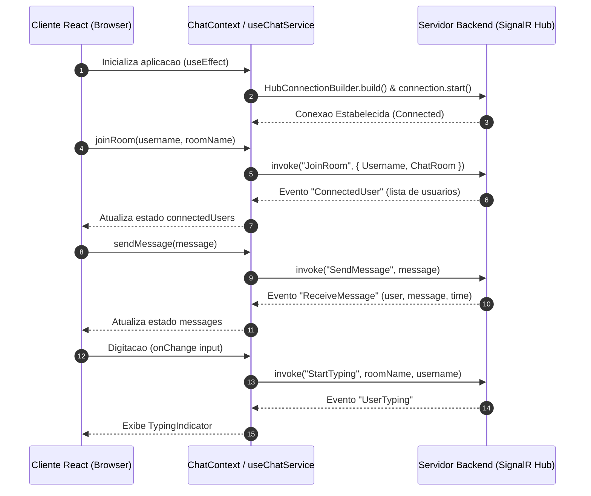

# Dialogue Frontend Client

O **Dialogue Frontend** e a interface web da aplicacao de comunicacao em tempo real Dialogue. Desenvolvido com React 19, TypeScript e Vite, o projeto utiliza a biblioteca Microsoft SignalR para estabelecer conexoes bidirecionais via WebSockets com o servidor backend, permitindo a criacao de salas de conversa, troca de mensagens instantaneas, listagem de usuarios ativos e indicadores de digitacao em tempo real.

---

## 1. Visao Geral e Arquitetura do Sistema

A arquitetura da aplicacao e fundamentada na separacao clara de responsabilidades entre a camada de apresentacao (Componentes React), a camada de estado e contexto (`ChatContext`), e a camada de comunicacao com o servidor (`chatService` / SignalR).

### Fluxo de Dados e Comunicacao



### Estrutura de Roteamento

A navegacao e gerenciada pela biblioteca `react-router-dom` v7 e compreende os seguintes caminhos:

* `/welcome`: Tela inicial de apresentacao do sistema.
* `/join-room`: Formulario para entrada na sala de bate-papo (coleta de nome de usuario e nome da sala).
* `/chat`: Interface principal do bate-papo contendo o historico de mensagens, lista de usuarios conectados e indicador de digitacao.
* `/`: Rota raiz com redirecionamento automatico para `/welcome`.

---

## 2. Especificacao do Contrato SignalR

A comunicacao em tempo real com o backend (hub padrao em `http://localhost:5000/chat`) segue o contrato estabelecido abaixo.

### Eventos Recebidos pelo Cliente (Inbound Events)

* `ReceiveMessage(user: string, message: string, messageTime: string)`: Notificacao enviada pelo servidor quando uma nova mensagem e transmitida na sala.
* `ConnectedUser(users: string[])`: Atualizacao com a lista de usuarios ativos na sala atual.
* `UserTyping(user: string)`: Notificacao informando que um usuario da sala iniciou a digitacao de uma mensagem.
* `UserStopTyping(user: string)`: Notificacao informando que o usuario interrompeu ou concluiu a digitacao.

### Metodos Invocados pelo Cliente (Outbound Methods)

* `JoinRoom({ Username: string, ChatRoom: string })`: Registra o usuario na sala de bate-papo especificada.
* `SendMessage(message: string)`: Transmite uma mensagem de texto para a sala ativa.
* `StartTyping(ChatRoom: string, Username: string)`: Sinaliza ao servidor que o usuario esta digitando.
* `StopTyping(ChatRoom: string, Username: string)`: Sinaliza ao servidor que a digitacao do usuario foi interrompida.
* `leaveChat()`: Invoca a interrupcao da conexao via `connection.stop()`.

---

## 3. Estrutura do Projeto

```text
Dialogue-front/
├── public/                  # Arquivos estaticos publicos
├── src/
│   ├── assets/              # Recursos visuais estaticos
│   ├── components/          # Componentes de interface reutilizaveis
│   │   └── dot/             # Componente de indicador de digitacao animado
│   │       └── index.tsx
│   ├── context/             # Gerenciamento de estado global via React Context
│   │   └── ChatContext.tsx  # Provedor do servico de chat
│   ├── pages/               # Paginas/Views da aplicacao
│   │   ├── chat/            # Interface principal do bate-papo
│   │   │   └── index.tsx
│   │   ├── join-room/       # Formulario de ingresso em sala
│   │   │   └── index.tsx
│   │   └── welcome/         # Tela de boas-vindas
│   │       └── index.tsx
│   ├── services/            # Servicos de integracao
│   │   └── chatService/     # Hook useChatService e integracao SignalR
│   │       └── index.ts
│   ├── App.tsx              # Componente raiz com definicao de rotas e providers
│   └── main.tsx             # Ponto de entrada da aplicacao React
├── eslint.config.js         # Configuracao do linter ESLint
├── index.html               # Documento HTML principal
├── package.json             # Dependencias e scripts do projeto
├── tsconfig.json            # Configuracao principal do TypeScript
├── tsconfig.app.json        # Configuracao TypeScript para a aplicacao
├── tsconfig.node.json       # Configuracao TypeScript para o ambiente Node/Vite
└── vite.config.ts           # Configuracao do empacotador Vite
```

---

## 4. Tecnologias e Bibliotecas

| Categoria | Tecnologia / Biblioteca | Versao | Finalidade |
| :--- | :--- | :--- | :--- |
| Linguagem | TypeScript | 5.9.x | Tipagem estatica e seguranca em tempo de compilacao |
| Framework UI | React | 19.1.x | Construcao da interface de usuario declarativa |
| Build Tool | Vite | 7.1.x | Empacotador e servidor de desenvolvimento de alta performance |
| Comunicacao Real-Time | @microsoft/signalr | 9.0.x | Cliente SignalR para conexao WebSocket com o backend |
| UI Components | Material UI (@mui/material) | 7.3.x | Sistema de componentes visuais baseados no Material Design |
| Icones | @mui/icons-material | 7.3.x | Iconografia padrao Material Design |
| Estilizacao | @emotion/react / @emotion/styled | 11.14.x | Engine de estilizacao CSS-in-JS |
| Roteamento | React Router DOM | 7.9.x | Roteamento no lado do cliente (SPA) |
| Utilitarios Visuais | react-avatar | 5.0.x | Geracao automatica de avatares com base no nome do usuario |

---

## 5. Requisitos e Instalacao

### Pre-requisitos

* Node.js na versao 18.x ou superior.
* Gerenciador de pacotes `npm` (versao 9.x+) ou `yarn`/`pnpm`.
* Backend do Dialogue em execucao (endpoint SignalR padrao em `http://localhost:5000/chat`).

### Passos de Instalacao

1. Clone o repositorio para o seu ambiente local:
   ```bash
   git clone <URL_DO_REPOSITORIO>
   cd Dialogue-front
   ```

2. Instale as dependencias do projeto:
   ```bash
   npm install
   ```

3. Inicie o servidor de desenvolvimento:
   ```bash
   npm run dev
   ```
   O aplicativo estara acessivel padronizadamente em `http://localhost:5173`.

---

## 6. Scripts Disponiveis

No diretorio do projeto, voce pode executar os seguintes comandos:

* `npm run dev`: Inicia a aplicacao em modo de desenvolvimento com suporte a HMR (Hot Module Replacement).
* `npm run build`: Compila os tipos TypeScript via `tsc -b` e gera o bundle otimizado de producao na pasta `dist/` atraves do Vite.
* `npm run lint`: Executa a analise estatica do codigo utilizando o ESLint.
* `npm run preview`: Executa um servidor local para visualizar a versao de producao gerada na pasta `dist/`.

---

## 7. Analise Tecnica e Recomendacoes de Engenharia

Com base na analise detalhada da base de codigo, destacam-se os seguintes pontos de atencao e recomendacoes para a evolucao do projeto:

### 1. Parametrizacao da URL da API (Variaveis de Ambiente)
Atualmente, a URL do endpoint SignalR esta fixada diretamente no codigo fonte (`http://localhost:5000/chat` em `src/services/chatService/index.ts`).
* **Recomendacao**: Mover o endpoint para uma variavel de ambiente (ex.: `import.meta.env.VITE_SIGNALR_HUB_URL`), permitindo alternar facilmente entre ambientes de desenvolvimento, staging e producao.

### 2. Resiliencia de Reconexao no SignalR
O SignalR esta configurado com `.withAutomaticReconnect()`. No entanto, apos uma reconexao automatica bem-sucedida, o estado do usuario na sala do backend pode ser perdido se o servidor nao persistir a sessao.
* **Recomendacao**: Adicionar ouvintes para o evento `connection.onreconnected` no `chatService` para re-executar a chamada de `JoinRoom` utilizando os dados armazenados no `localStorage` ou no estado da aplicacao.

### 3. Gerenciamento de Persistencia Local e Guardas de Rota
A aplicacao utiliza `localStorage` para manter o nome do usuario e da sala.
* **Recomendacao**: Implementar guardas de rota (Protected Routes) na pagina `/chat` para redirecionar o usuario de volta a rota `/join-room` caso `username` ou `roomName` nao estejam definidos ou se a conexao SignalR estiver inativa.

### 4. Otimizacao do Bundle de Producao
Durante a compilacao (`npm run build`), o empacotador sinaliza que o chunk principal excede 500 kB devido ao peso combinado das bibliotecas `@mui/material` e `@microsoft/signalr`.
* **Recomendacao**: Configurar `manualChunks` no `vite.config.ts` para realizar o code-splitting das dependencias de terceiros (`vendor chunks`).
