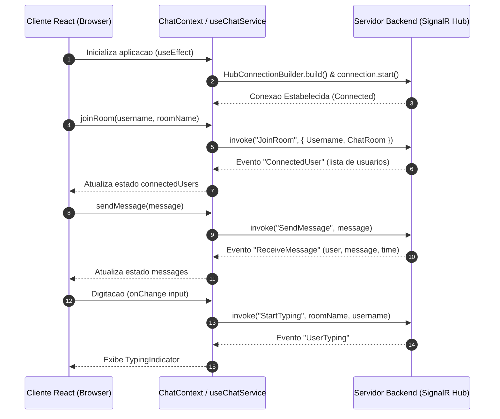

# Dialogue Frontend Client

O **Dialogue Frontend** e a interface web da aplicacao de comunicacao em tempo real Dialogue. Desenvolvido com React 19, TypeScript e Vite, o projeto utiliza a biblioteca Microsoft SignalR para estabelecer conexoes bidirecionais via WebSockets com o servidor backend, permitindo a criacao de salas de conversa, troca de mensagens instantaneas, listagem de usuarios ativos e indicadores de digitacao em tempo real.

---

## 1. Visao Geral e Arquitetura do Sistema

A arquitetura da aplicacao e fundamentada na separacao clara de responsabilidades entre a camada de apresentacao (Componentes React), a camada de estado e contexto (`ChatContext`), e a camada de comunicacao com o servidor (`chatService` / SignalR).

### Fluxo de Dados e Comunicacao



### Estrutura de Roteamento

A navegacao e gerenciada pela biblioteca `react-router-dom` v7 e compreende os seguintes caminhos:

* `/welcome`: Tela inicial de apresentacao do sistema.
* `/join-room`: Formulario para entrada na sala de bate-papo (coleta de nome de usuario e nome da sala).
* `/chat`: Interface principal do bate-papo contendo o historico de mensagens, lista de usuarios conectados e indicador de digitacao.
* `/`: Rota raiz com redirecionamento automatico para `/welcome`.

---

## 2. Especificação do Contrato SignalR & WebRTC

A comunicação em tempo real com o backend (`/chat`) é gerenciada pela classe [`chatSignalR`](file:///home/jona/Área de trabalho/Dialogue/frontend/src/services/chatService/index.ts) com resolução dinâmica de host (`window.location.origin` ou `VITE_API_URL`).

### Eventos Recebidos pelo Cliente (Inbound Events)

#### Mensageria e Presença:
* `ReceiveMessage(user: string, message: string, timestampUtc?: string, messageId?: string)`: Transmite mensagens para a sala.
* `ConnectedUser(users: string[])`: Lista de nomes dos usuários ativos na sala.
* `ConnectedUsersDetailed(users: ConnectedUserDetailed[])`: Detalhes de conexões com `connectionId` para roteamento WebRTC.
* `UserTyping(user: string)`: Notificação de início de digitação.
* `UserStopTyping(user: string)`: Notificação de término de digitação.

#### Sinalização WebRTC 1:1:
* `ReceiveCallOffer(callerConnectionId: string, callerUsername: string, sdpOffer: string)`: Oferta SDP de chamada recebida de um participante.
* `ReceiveCallAnswer(answererConnectionId: string, sdpAnswer: string)`: Resposta SDP recebida do destinatário da chamada.
* `ReceiveIceCandidate(senderConnectionId: string, candidateJson: string)`: Candidato de rede ICE transmitido pelo par.
* `CallRejected(responderConnectionId: string)`: Notificação de recusa de chamada.
* `CallEnded(senderConnectionId: string)`: Notificação de encerramento de chamada pelo par.
* `CallUnavailable(targetUsername: string)`: Alerta indicando que o usuário chamado está offline ou inacessível.

### Métodos Invocados pelo Cliente (Outbound Methods)

* `JoinRoom({ Username: string, ChatRoom: string })`: Conecta e registra o usuário na sala.
* `SendMessage(message: string)`: Envia mensagem para a sala.
* `StartTyping(ChatRoom: string, Username: string)` / `StopTyping(...)`: Controle de digitação.
* `CallUser(targetUsername: string, sdpOffer: string)`: Inicia oferta de chamada WebRTC 1:1.
* `AnswerCall(callerConnectionId: string, sdpAnswer: string)`: Aceita a chamada com SDP Answer.
* `SendIceCandidate(targetConnectionId: string, candidateJson: string)`: Envia candidato ICE para o par.
* `RejectCall(callerConnectionId: string)`: Rejeita chamada recebida.
* `HangUp(targetConnectionId: string)`: Encerra chamada ativa.

---

## 3. Estrutura do Projeto

```text
frontend/
├── public/                  # Arquivos estáticos
├── src/
│   ├── components/          # Componentes reutilizáveis
│   │   ├── call/            # Modais de chamada WebRTC
│   │   │   ├── IncomingCallModal.tsx # Toque e aceite/recusa de chamada
│   │   │   └── VideoCallModal.tsx    # Vídeo remoto, PiP local e controles
│   │   └── dot/             # Indicador animado de digitação
│   ├── context/             # Provedor global ChatContext
│   │   └── ChatContext.tsx
│   ├── hooks/               # Custom hooks
│   │   └── useWebRTC.ts     # Gerenciamento de RTCPeerConnection e streams
│   ├── lib/                 # Configuração de clientes (TanStack Query)
│   ├── pages/               # Páginas da aplicação
│   │   ├── chat/            # Interface principal do chat
│   │   ├── join-room/       # Entrada em sala com healthcheck
│   │   └── welcome/         # Tela de boas-vindas
│   ├── services/            # Clientes de rede
│   │   ├── api.ts           # Axios com resolução dinâmica de origem
│   │   └── chatService/     # Singleton SignalR com listeners WebSockets
│   ├── stores/              # Estado atômico Zustand
│   │   └── useChatStore.ts  # Mensagens, presença e estado de chamadas
│   ├── theme/               # Tema moderno Dark Slate / Índigo
│   ├── App.tsx              # Rotas e provedores principais
│   └── main.tsx             # Ponto de entrada React 19
├── Dockerfile               # Multi-stage build com Nginx SPA
├── nginx.conf               # Configuração interna de rotas SPA
└── package.json
```

---

## 4. Tecnologias e Bibliotecas

| Categoria | Tecnologia / Biblioteca | Versão | Finalidade |
| :--- | :--- | :--- | :--- |
| Linguagem | TypeScript | 5.9.x | Tipagem estática e segurança em tempo de compilação |
| Framework UI | React | 19.x | Construção da interface declarativa de alta performance |
| Build Tool | Vite | 7.x | Empacotador rápido com Hot-Module Replacement |
| Comunicação Real-Time | @microsoft/signalr | 9.0.x | Cliente SignalR para WebSockets |
| Chamadas P2P | WebRTC nativo | - | Áudio e vídeo 1:1 via Google STUN |
| Gerenciamento de Estado | Zustand | 5.0.x | Streaming reativo de mensagens e estado de chamada |
| Cache & Server State | TanStack Query | 5.66.x | Monitoramento assíncrono de saúde da API |
| Componentes UI | Material UI | 7.3.x | Design system moderno com Dark Mode e Glassmorphism |
| Ícones | @mui/icons-material | 7.3.x | Iconografia oficial do Material Design |

---

## 5. Requisitos e Instalacao

### Pre-requisitos

* Node.js na versao 18.x ou superior.
* Gerenciador de pacotes `npm` (versao 9.x+) ou `yarn`/`pnpm`.
* Backend do Dialogue em execucao (endpoint SignalR padrao em `http://localhost:5000/chat`).

### Passos de Instalacao

1. Clone o repositorio para o seu ambiente local:
   ```bash
   git clone <URL_DO_REPOSITORIO>
   cd Dialogue-front
   ```

2. Instale as dependencias do projeto:
   ```bash
   npm install
   ```

3. Inicie o servidor de desenvolvimento:
   ```bash
   npm run dev
   ```
   O aplicativo estara acessivel padronizadamente em `http://localhost:5173`.

---

## 6. Scripts Disponiveis

No diretorio do projeto, voce pode executar os seguintes comandos:

* `npm run dev`: Inicia a aplicacao em modo de desenvolvimento com suporte a HMR (Hot Module Replacement).
* `npm run build`: Compila os tipos TypeScript via `tsc -b` e gera o bundle otimizado de producao na pasta `dist/` atraves do Vite.
* `npm run lint`: Executa a analise estatica do codigo utilizando o ESLint.
* `npm run preview`: Executa um servidor local para visualizar a versao de producao gerada na pasta `dist/`.

---

## 7. Analise Tecnica e Recomendacoes de Engenharia

Com base na analise detalhada da base de codigo, destacam-se os seguintes pontos de atencao e recomendacoes para a evolucao do projeto:

### 1. Parametrizacao da URL da API (Variaveis de Ambiente)
Atualmente, a URL do endpoint SignalR esta fixada diretamente no codigo fonte (`http://localhost:5000/chat` em `src/services/chatService/index.ts`).
* **Recomendacao**: Mover o endpoint para uma variavel de ambiente (ex.: `import.meta.env.VITE_SIGNALR_HUB_URL`), permitindo alternar facilmente entre ambientes de desenvolvimento, staging e producao.

### 2. Resiliencia de Reconexao no SignalR
O SignalR esta configurado com `.withAutomaticReconnect()`. No entanto, apos uma reconexao automatica bem-sucedida, o estado do usuario na sala do backend pode ser perdido se o servidor nao persistir a sessao.
* **Recomendacao**: Adicionar ouvintes para o evento `connection.onreconnected` no `chatService` para re-executar a chamada de `JoinRoom` utilizando os dados armazenados no `localStorage` ou no estado da aplicacao.

### 3. Gerenciamento de Persistencia Local e Guardas de Rota
A aplicacao utiliza `localStorage` para manter o nome do usuario e da sala.
* **Recomendacao**: Implementar guardas de rota (Protected Routes) na pagina `/chat` para redirecionar o usuario de volta a rota `/join-room` caso `username` ou `roomName` nao estejam definidos ou se a conexao SignalR estiver inativa.

### 4. Otimizacao do Bundle de Producao
Durante a compilacao (`npm run build`), o empacotador sinaliza que o chunk principal excede 500 kB devido ao peso combinado das bibliotecas `@mui/material` e `@microsoft/signalr`.
* **Recomendacao**: Configurar `manualChunks` no `vite.config.ts` para realizar o code-splitting das dependencias de terceiros (`vendor chunks`).
